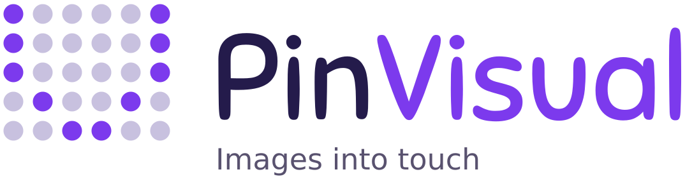

<p align="center">
  <picture>
    <source media="(prefers-color-scheme: dark)" srcset="./assets/images/logo-dark.svg">
    
  </picture>
</p>

<p align="center">
  <a href="https://github.com/zyh-29/SLDP-PinVisual/actions/workflows/ci.yml"></a>
  <a href="https://zongyaohuang.com/pinvisual"></a>
</p>

# PinVisual 📍

PinVisual is a React Native / Expo app for a **tactile pin display**, built so
blind and low-vision people can feel pictures, shapes, letters and graphs. You
draw a pattern, give it a picture, or say what you want, and it works out which
pins should be up and which should be down. The pattern goes over Bluetooth Low
Energy to an ESP32, which moves one servo per pin through PCA9685 servo boards.

Everything runs on the device. There are no accounts and no backend, and
nothing leaves the device unless you turn on an online feature (picture search
or online speech recognition).

> 🌐 **The app is accessible at [zongyaohuang.com/pinvisual](https://zongyaohuang.com/pinvisual)**,
> with nothing to install. It works in any modern browser and can be added to a
> phone's home screen. Use Chrome or Edge to connect to a board over Bluetooth.

## 📱 App Information

- **Version:** 1.0.0
- **Platforms:** iOS, Android and web
- **Grid:** 5 × 6 (30 pins), set in `src/config/hardware.ts`
- **Bundle ID (iOS) / Package (Android):** `com.sldp.pinvisual`
- **Web app:** [zongyaohuang.com/pinvisual](https://zongyaohuang.com/pinvisual)

## ✨ Features

### Core Features

- ✏️ **Draw on the grid** and send the pattern to the board
- 🖼️ **Picture to pins** - photos, drawings, graphs, shared screens and the live
  camera, with automatic background removal, smart cropping and shape snapping
  ([how it works](docs/IMAGING.md))
- 📈 **Graphs and equations** - type `y = x^2 - 3` or point the camera at a graph;
  pick the range, zoom, pan and hear a description
- 🎙️ **Voice commands** - spoken or typed: "show a circle", "letter B", "graph y
  equals x squared", "send" ([full list](docs/VOICE.md))
- 🔤 **Letters and digits** - A–Z and 0–9 drawn for the pins
- 💾 **Saved patterns** with backup export and import

### Technical Features

- 🔒 **On-device everything** - image processing, subject cut-out and voice
  understanding run locally
- 🧠 **Smart Cut-Out** - Apple Vision (iOS 17+), ML Kit (Android), U²-Net with
  ONNX Runtime Web (browser)
- 🗣️ **Built-in voice model** - a small fastText-style network (177 KB) that
  understands commands phrased many ways, with no download
- 📡 **Reliable Bluetooth protocol** - framing, CRC-16, chunking, ACKs, retries
  and timeouts ([spec](docs/PROTOCOL.md))
- ✈️ **Works offline** on the web after the first visit, and installs to a
  phone's home screen
- ♿ **Screen reader first** - every pin, preview and result is announced
- 🌓 **Light and dark mode**, following Apple's Human Interface Guidelines

## 🚧 Project Status

The app works in the iOS simulator and in Chrome. Bluetooth has been tested
against a simulated board but **not yet against real hardware**. The checklist for
real-device testing is in [docs/TESTING.md](docs/TESTING.md).

| Feature | Status |
|---|---|
| Drawing, Clear Grid, saving and loading | ✅ Works |
| Picture to pins, shape snapping, tap to pick | ✅ Works on the web; not yet run through on a phone |
| Graph Range, zoom, panning, typed equations | ✅ Works. Axis numbers are read on the web only; on phones one grid square counts as one unit |
| Letters and digits on the pins | ✅ Works |
| Web layout (laptop, tablet, phone) | ✅ Works |
| Protocol (framing, CRC, chunking, retries, ACKs) | ✅ Done, with unit tests |
| Smart Cut-Out | 🟡 Works on the web; iOS and Android need a development build |
| Live camera, lock and capture (web) | 🟡 Works in Chrome; not yet tried on a real phone |
| Voice commands | 🟡 Works in Chrome by typing and with a stand-in recogniser; not yet tried with a real microphone, VoiceOver or TalkBack |
| Picture search (Openverse, Wikimedia Commons) | 🟡 Wikimedia works; Openverse untested live |
| Backup export and import | 🟡 Works on the web; phone share sheet untested |
| Send Pattern, Reset, Send Live | 🟡 Tested against a simulated board only |
| Bluetooth on phones, Web Bluetooth | 🟡 Written, never run against a board |
| On-device AI suggestions, Speak Results | 🟡 Written; tested with stand-ins only |
| Board firmware (ESP32 + PCA9685) | 🟡 Protocol code passes its tests; not yet flashed to an ESP32 |
| Letter recognition from a picture | ⬜ Not started |
| Pin position feedback | ⬜ Not possible: the hardware has no position sensors |

## 🛠️ Technology Stack

### Framework & Core

- **Expo** SDK 58
- **React Native** 0.88 with React 19.3 and the React Compiler
- **TypeScript** 6.0
- **Expo Router** (file-based routing, typed routes)
- **React Native Web** for the browser version

### Device & Hardware

- **react-native-ble-plx** (Bluetooth on phones) and **Web Bluetooth** (Chrome, Edge)
- **ESP32 + PCA9685** firmware in `firmware/` (Arduino, C++)

### Imaging & AI

- **ONNX Runtime Web** + **U²-Net** small model (browser subject cut-out)
- **Apple Vision** / **Google ML Kit** through a local Expo module (`modules/subject-segmentation`)
- **Tesseract.js** (reads graph axis numbers on the web)
- Hand-written image pipeline: lighting correction, GrabCut-style refinement,
  ORB feature tracking, shape fitting

### Voice & Accessibility

- **expo-speech-recognition** and the Web Speech API (speech to text)
- **expo-speech** (Speak Results)
- On-device intent model trained with `npm run train:voice`

### Storage

- **AsyncStorage** for saved patterns
- React Context for app state

## 💻 Running It Locally

Requires Node.js 22.13 or newer.

```bash
git clone https://github.com/zyh-29/SLDP-PinVisual.git
cd SLDP-PinVisual
npm install
npm run web        # opens at http://localhost:8081
```

Bluetooth on phones needs a [development build](https://docs.expo.dev/develop/development-builds/introduction/)
(`npm run ios` / `npm run android`); Expo Go runs everything else.

## 🔌 Hardware

| What | Where |
|---|---|
| Parts, wiring, flashing, calibration | [firmware/README.md](firmware/README.md) |
| Bluetooth protocol and test vectors | [docs/PROTOCOL.md](docs/PROTOCOL.md) |
| Grid size, BLE UUIDs, timing | `src/config/hardware.ts` |
| Real phone and board test checklist | [docs/TESTING.md](docs/TESTING.md) |

You can start with **a single servo and no servo boards**: see "Testing with
one servo" in the firmware README, then use the app's **Pin Test** tab.

### How the App Talks to the Board

1. Editing never sends anything. The board only changes on **Send Pattern** or
   **Reset Physical Pins**
2. The app waits for an ACK with the matching command ID. A finished Bluetooth
   write alone doesn't count as success
3. No ACK → it retries up to three times, then offers Retry
4. Reset clears the preview only after the board acknowledges it
5. Only one command runs at a time

## 📁 Project Structure

```
./
├── src/
│   ├── app/              # Expo Router screens: Display, Image, Saved, Device, Pin Test
│   ├── config/           # hardware.ts: grid size, BLE UUIDs, protocol timing
│   ├── domain/           # Grid model, pin order, bit packing
│   ├── protocol/         # Message encoding, CRC-16, chunking, ACKs and retries
│   ├── device/           # Bluetooth drivers (phone + web), DeviceController, LiveSender
│   ├── imaging/          # Picture to pins pipeline (see docs/IMAGING.md)
│   ├── voice/            # Voice commands and on-device intent model (see docs/VOICE.md)
│   ├── storage/          # Saved patterns and backup files
│   ├── state/            # React providers and hooks
│   ├── ui/               # Theme, components, tab bar and sidebar
│   └── offline/          # Service worker registration (web)
├── modules/
│   └── subject-segmentation/  # Local Expo module: Apple Vision + ML Kit
├── firmware/             # ESP32 sketch and its protocol tests
├── scripts/              # Web build steps, engine copy, voice model training
├── public/               # Static web files, including the U²-Net model
└── docs/                 # Protocol, imaging, voice and testing docs
```

Files ending in `.web.ts` / `.web.tsx` are the browser versions of the file with
the same name. The tests use a simulated board (`src/device/__tests__/support`)
that can be made slow, lossy or faulty.

## 📚 Documentation

| Doc | What's in it |
|---|---|
| [docs/IMAGING.md](docs/IMAGING.md) | How a picture becomes pins: lighting, background, cropping, landscapes, graphs, live camera, screen sharing |
| [docs/VOICE.md](docs/VOICE.md) | Every voice command, how sentences are understood, retraining and measuring the model |
| [docs/PROTOCOL.md](docs/PROTOCOL.md) | The Bluetooth protocol between app and board |
| [docs/TESTING.md](docs/TESTING.md) | Manual checklists for real phones, real boards and blind testers |
| [firmware/README.md](firmware/README.md) | Building, wiring and flashing the board |

## ♿ Accessibility

- Nothing relies on colour alone: raised pins are solid, lowered pins are rings,
  and every status has an icon and text. Text meets WCAG AA contrast
- Grid cells are at least 40 pt; on narrow screens the grid scrolls instead of
  shrinking
- Screen readers announce each pin ("Row 2, column 3, raised"), summarise
  previews row by row, and announce send, reset and save results
- Voice commands sit before the 30 pins, so a screen reader reaches them first

## 🙏 Acknowledgments

- Built with [Expo](https://expo.dev) and [React Native](https://reactnative.dev)
- Subject cut-out model: [U²-Net](https://github.com/xuebinqin/U-2-Net) (Apache-2.0)
- Browser inference: [ONNX Runtime Web](https://github.com/microsoft/onnxruntime) (MIT)
- Graph numbers: [Tesseract.js](https://github.com/naptha/tesseract.js) (Apache-2.0)
- Picture search: [Openverse](https://openverse.org) and
  [Wikimedia Commons](https://commons.wikimedia.org); the app reads out each
  picture's credit and license
